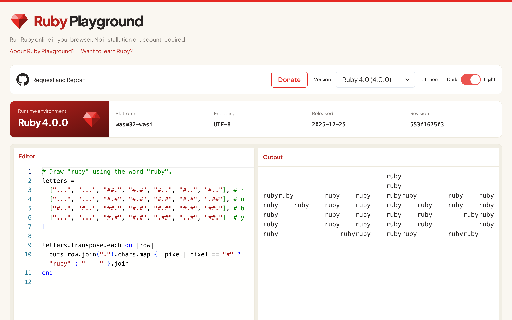
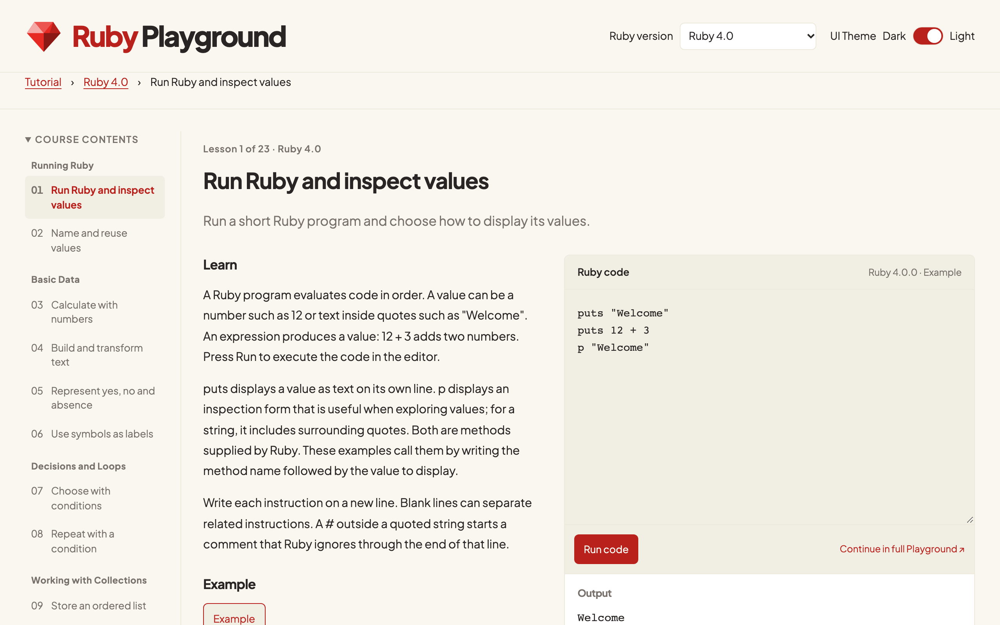

# Ruby Playground

Ruby Playground is a free website for writing and running Ruby in your browser:
<https://ruby-play.dev/>. Type Ruby in the editor and the output updates as you
edit. You can switch between Ruby versions and share code by copying the URL.
No installation or account is required. Ruby runs inside the browser with
[ruby.wasm](https://github.com/ruby/ruby.wasm), so your code is not sent to a
server to be executed.

The site also includes a step-by-step [Ruby tutorial](https://ruby-play.dev/tutorial/)
whose lessons run code in the page.

## Features

- Live execution. Code runs shortly after you stop typing. Standard output,
  standard error and exceptions appear in the Output panel as plain text. Use
  `puts` or `p` to print values; expression return values are not shown
  automatically.
- Ruby versions. Choose from several Ruby versions, including a development
  snapshot. The selector shows the exact bundled patch version, and a panel
  shows the running VM's version, platform, encoding, release date and revision.
- Sharing by URL. The code and selected version are saved in the address bar as
  you edit. Copy the URL to share an example or bookmark it. Opening a shared
  link restores the code and runs it.
- Ruby tutorial. Lessons are grouped into chapters, from the basics to classes
  and more advanced syntax. Each lesson has an explanation, an example and
  experiments to run and edit. Each Ruby version has its own course at
  `/tutorial/{version}/`.
- Light and dark themes. The theme follows your system setting, and a theme you
  choose is remembered across reloads.

## Limitations

- Programs are single files. Standard input (`gets`), Rails, additional gems and
  saved snippets are not supported.
- Each run starts in a new Ruby VM, so variables, constants and files from
  earlier runs are not kept.
- Run time, output size, code length and share URL length are limited. The
  page shows a message when a limit is reached. Code that is too long for the
  URL still runs but is not saved in the URL.
- The first run downloads the selected runtime, which is tens of megabytes, and
  can be slow on a slow connection.
- The runtimes are official ruby.wasm builds. They can be older than the latest
  Ruby patch releases and can lack recent security fixes. The selector shows
  the exact patch version.

## Security and privacy

- Code runs in your browser in a Web Worker. Each run uses a new Worker and
  Ruby VM, and Ruby's JavaScript bridge is disabled. The Worker keeps the page
  responsive and separates runs, but it is not a security sandbox for hostile
  code. Run only code you trust.
- Shared links run automatically when opened, and the URL contains the full
  source code. Do not open links from sources you do not trust, and keep
  passwords and personal information out of your code. Because the code is part
  of the URL, it can remain in browser history and in hosting request logs.
- The site is a static site on GitHub Pages. There are no accounts and no
  application backend, and the site uses no analytics or advertising. See the
  [privacy policy](https://ruby-play.dev/privacy.html).

## Feedback and contributing

Report bugs and request features in
[GitHub issues](https://github.com/glassmonkey/ruby-playground/issues) or by DM
to [@glassmonekey](https://twitter.com/glassmonekey). For local setup, tests,
deployment and tutorial authoring, see [docs/contributing.md](docs/contributing.md).

You can support the project through
[GitHub Sponsors](https://github.com/sponsors/glassmonkey).

## License

Apache License 2.0. See [LICENSE](LICENSE) and [NOTICE](NOTICE). The build
configuration is adapted from
[php-playground](https://github.com/glassmonkey/php-playground). License
notices for Ruby and ruby.wasm are in [assets/licenses/](assets/licenses/).
