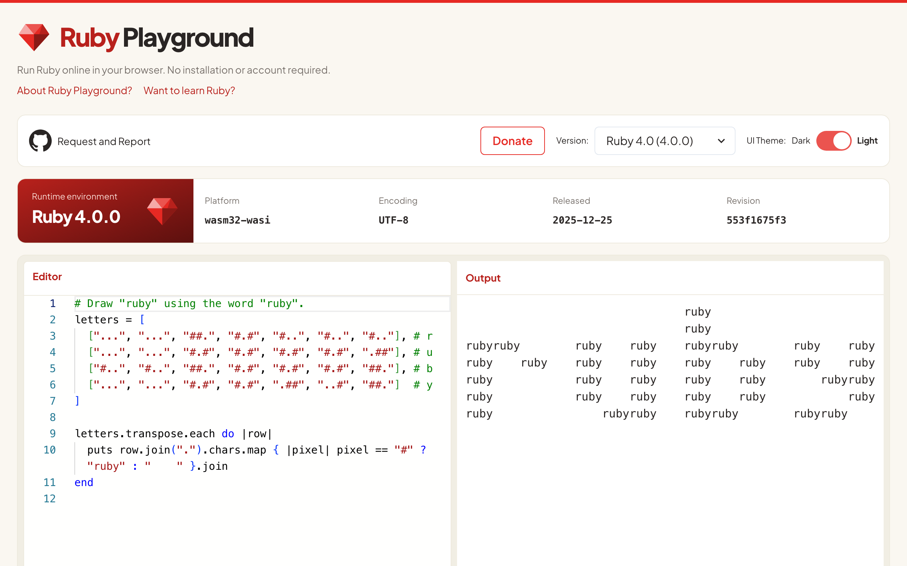
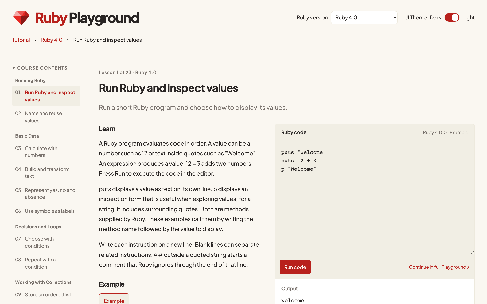

# Ruby Playground

Ruby Playground is a free website for writing and running Ruby in your browser:
<https://ruby-play.dev/>. Type Ruby in the editor and the output updates as you
edit. You can switch between Ruby versions and share code by copying the URL.
No installation or account is required. Ruby runs inside the browser with
[ruby.wasm](https://github.com/ruby/ruby.wasm), so your code is not sent to a
server to be executed.



The site also includes a step-by-step [Ruby tutorial](https://ruby-play.dev/tutorial/)
whose lessons run code in the page.



## Features

- Live execution. Code runs shortly after you stop typing. Standard output,
  standard error and exceptions appear in the Output panel as plain text. Use
  `puts` or `p` to print values; expression return values are not shown
  automatically.
- Ruby code completion. The main editor uses TypeProf 0.33.2 for Ruby 3.3 and
  4.0. Completion is enabled by default and can be turned off in the editor
  controls. Unsupported Ruby versions keep editing and execution available
  without downloading analysis assets. Shared URLs save the disabled state as
  `ac=0`.
- Ruby versions. Choose from several Ruby versions, including a development
  snapshot. The selector shows the exact bundled patch version, and a panel
  shows the running VM's version, platform, encoding, release date and revision.
- Sharing by URL. The code and selected version are saved in the address bar as
  you edit. Copy the URL to share an example or bookmark it. Opening a shared
  link restores the code and runs it. A shared link can also include a Gemfile
  and locked gem versions; opening it may download and run those third-party
  gems in your browser.
- Additional gems. Add supported `gem "name"` entries to the Gemfile and run
  `bundle install`. Dependency metadata and gem packages are fetched through
  the project's gem proxy. Installed `.gem` files are cached in browser Cache
  Storage.
- Ruby tutorial. Lessons are grouped into chapters, from the basics to classes
  and more advanced syntax. Each lesson has an explanation, an example and
  experiments to run and edit. Each Ruby version has its own course at
  `/tutorial/{version}/`.
- Light and dark themes. The theme follows your system setting, and a theme you
  choose is remembered across reloads.

## Limitations

- Gemfiles support `gem "name"` with version requirements and the default
  rubygems.org source. Other Gemfile directives and sources are not supported.
  Gems that require threads, sockets or native C extensions cannot run in the
  current ruby.wasm WASI runtimes.
- Rails and saved snippets are not supported.
- User programs are single files, and standard input (`gets`) is not supported.
- Each run starts in a new Ruby VM, so variables, constants and files from
  earlier runs are not kept.
- Run time, output size, code length and share URL length are limited. The
  page shows a message when a limit is reached. Code that is too long for the
  URL still runs but is not saved in the URL.
- The first run downloads the selected runtime, which is tens of megabytes, and
  can be slow on a slow connection.
- The runtimes are official ruby.wasm builds. They can be older than the latest
  Ruby patch releases and can lack recent security fixes. The selector shows
  the exact patch version.
- Ruby completion uses the matching RBS core for Ruby 3.3 or 4.0. Completion is
  unavailable for Ruby 3.2, 3.4 and 4.1, and the signature data can omit APIs
  that are not present in its RBS release.
- TypeProf completion is inference-based, not a complete model of Ruby method
  visibility or every nested implicit call. The matching RBS core filters
  private core methods according to its signatures, but an explicit receiver
  may still show a user-defined private method such as `Box#hidden`. Nested
  implicit calls are also outside the verified behavior. This limitation is
  separate from the tested Ruby 3.3/4.0 prefix insertion, suffix preservation,
  and `self` inference cases.

## Ruby completion verification

The completion-only Chromium suite runs against a production Vite build with
`PORT=6645 npx playwright test --config=e2e/completion.config.ts`. The isolated
config starts only Vite preview and matches `completion.spec.ts`; it does not
start or reuse the gem proxy or workerd. An earlier full run on UI source head
`c60ee92b84bcdd979e68a9b6fa698469d19e8524` passed all 14 tests. Its screenshots,
traces and protocol captures are archived under
`test-results/archive/c60ee92b84bcdd979e68a9b6fa698469d19e8524/completion-e2e-full-run2/`.
A later full run on local UI head `4d6f0a1f68d49159d32488723eb20400f8f7751f`
passed 13 tests and failed one midline `upcase` candidate wait. Its failure
trace and a readback correcting the invocation's mistyped head/hash metadata
are documented under
`test-results/archive/4d6f0a1f68d49159d32488723eb20400f8f7751f/completion-final-run1/`.
The run was executed from local head 4d6f; the published PR was still at c60.

That run used manifest SHA-256
`c93e49dc7769caf55ff2e14a70af56a042bfaa894b956b944db44d715edc3e13` and
analysis WASM SHA-256
`913e37a91777a0e9e5ef6114eb0b3dc8e1d3ac990a15c144c6a0afc606daae5c` (67,732,288
bytes). The WASM was copied from the runtime worktree to this worktree's
ignored build input; the asset manifest was generated from this branch's
adapter. The adapter did not change on runtime heads 0cabb, e598 or ecee, so
the WASM was not rebuilt. An earlier local measurement recorded 2,075 ms to
completion-ready, 1,267 ms Worker initialization, 1,312 ms to first candidate,
87 ms to a warm candidate, and 20,698,694 bytes across five LSP HTTP response
bodies. These are local measurements, not production-network timings.

On the later 4d6 product build, the archived browser metrics recorded 4,337 ms
from navigation to completion-ready, 3,077 ms Worker initialization, 2,391 ms
from natural `.upc` input to the first candidate, and 118 ms for a warm
candidate. The five HTTP LSP bodies totaled 20,698,694 bytes: 20,245,121 bytes
for the compressed analysis WASM, 450,443 bytes for the compressed Ruby 4.0
core, and 3,130 bytes for the manifest/adapter/source files. The run's head and
test-source hash fields were mistyped; actual values are read back in
`test-results/archive/4d6f0a1f68d49159d32488723eb20400f8f7751f/completion-final-run1/run-readback.json`.

The earlier completion E2E covers natural `upcase` and `greeting` insertion and Ruby
execution, `put`→`puts`, midline suffix preservation, Japanese and emoji UTF-16
positions, `Mine#rfind` shadowing/removal, version-specific API candidates,
the Fiber details matrix, completion OFF and URL/history restoration, initial
OFF without LSP asset fetch, unsupported versions 3.2/3.4/4.1, analysis failure,
Worker disposal/recreation, no-result behavior, and a forced completion
response delivered after OFF disposes its Worker. The late-response test is
E2E-only instrumentation; no production editor, client or Worker code is
changed by it.

The Fiber UI matrix on UI source head
`c60ee92b84bcdd979e68a9b6fa698469d19e8524` used an uncommitted probe diff SHA-256
`afbcbbf24e81069fb832517d3de0d18b0a6af4fdf7933b5f43003a2fc0f9c10c`. The
analysis-ready generations were `3.3` / worker 1, `4.0` / worker 2 and restored
`3.3` / worker 3. Each completion token 6 and resolve token 7 matched the same
worker, document version and candidate identity (`raise`, data and textEdit).
The rendered details showed `raise(msg = <default>)` without `cause` in 3.3
and `raise(msg = <default>, cause: <default>)` in 4.0. Raw responses, rendered
DOM, screenshots and trace are archived under
`test-results/archive/c60ee92b84bcdd979e68a9b6fa698469d19e8524/fiber-visible-signature-run2/`.

The test compares the first rendered line in `.suggest-details .docs` because
the LSP completion item has no `detail` field: Monaco's `.header .type` is
therefore empty, and list labels such as `raise, Method` do not carry the
version-specific signature. The displayed documentation is the public UI
result of resolving and rendering the candidate.

On local head `4d6f0a1f68d49159d32488723eb20400f8f7751f`,
`npm run test:ci` passed 225 tests before the runtime unmount component tests
were merged. After merging runtime test-only commit
`a3ffd23fb6bda3ad09f1beab69866cdccb310d3d`, `npm run test:ci` passed 227 tests
in 22 files; typecheck and lint also passed. The full repository
proxy/general E2E suite and CI are separate and are not represented by the
completion-only suite. No public UI action unmounts the editor, so that browser
path remains unverified. The runtime component-boundary tests in `src/editor.test.tsx`
unmount `RubyEditor` while completion or resolve is pending, then check Worker
termination, Monaco provider disposal and suppression of a delayed result. The
tests use React Testing Library and a fake Worker; they are component tests,
not a browser-page unmount test. The UI lane's one-case observer diagnostic
succeeded on the midline input: Worker 1 returned `+` and `+@` for document
version 32, then `upcase` and `upcase!` for version 35; the UI inserted
`upcase` and Ruby printed `HELLO!`. The preceding full-run failure remains
unexplained because that run has no corresponding Worker log. Its historical
failure and the later successful diagnostic remain separate records at
`test-results/archive/4d6f0a1f68d49159d32488723eb20400f8f7751f/`.

Browser history navigation preserves the completion status when only the
source changes while the Ruby version and enabled setting stay the same.
Changing either setting recalculates status; code-only history moves keep the
existing ready or unavailable state and reuse the current analysis Worker.

After merging runtime completion request fix `765943e3866c2136de8631660e6756db757cafd4`,
the full isolated Chromium completion suite passed 14/14 on UI merge head
`7659f5c883d99257ba27db790e822e30a01d0ccb`. The run includes the previously
failing midline case: natural `.upc` input in `puts "hello" + "!"` preserved
the trailing ` + "!`,
inserted `upcase`, and Ruby printed `HELLO!`. The full repository unit suite
passed 231 tests in 22 files on that head. Typecheck, lint, production build,
asset verification, and `git diff --check` also passed. This new successful
run does not establish the cause of the earlier 4d6 failure; its trace did not
contain the matching Worker request data.

The exact full-run command, source hashes, output screenshots, protocol files,
traces and result marker are archived at
`test-results/archive/7659f5c883d99257ba27db790e822e30a01d0ccb/completion-final-run1/`.
The full-run `.last-run.json` reports `passed` with no failed tests. The
midline-only run and the focused five-test priority run have separate archives
under the same head directory. All runs used manifest SHA-256
`c93e49dc7769caf55ff2e14a70af56a042bfaa894b956b944db44d715edc3e13` and
analysis WASM SHA-256
`913e37a91777a0e9e5ef6114eb0b3dc8e1d3ac990a15c144c6a0afc606daae5c`
(67,732,288 bytes). The WASM is the ignored build input copied from the
runtime worktree; assets were built from this branch's adapter. The runtime
change does not modify the Ruby adapter or asset source, so no WASM rebuild
was done. Focused measurements on the same product head are documented in
`completion-priority-run1/README.md`; they use local Vite preview and are not
production-network timings.

This UI result verifies component-level Worker/provider disposal through the
runtime's two `RubyEditor` unmount tests, including pending completion/resolve.
It does not verify unmount through a public browser-page control because the
product exposes no such control. PR acceptance, CI status and the separate
runtime investigation into stale-response behavior remain manager/secretary
work; this local run does not claim those decisions.

## TypeProf completion verification

The user requested a TypeProf rewrite. Runtime commit
`faf9cc800af8fdfbbc09bbe384c9c6fb0d84f258` and its URI mapping follow-up
`f601837c6c6772b37a213d398d1048944d69ad4c` were integrated into this UI lane.
The manager accepted the TypeProf 0.33.2 PoC's Ruby 3.3/4.0 versioned-core
feasibility after checking the version-matrix script and artifact hashes. That
PoC proves raw inference and adapter examples only; Monaco/provider behavior is
verified separately by the browser suite below. Historical Ruby LSP results
above are not TypeProf results.

The UI preserves the completion toggle, `ac=0` URL state, selected Ruby
version, and loading/ready/unsupported/error status through the existing
`RubyEditor` props. The UI lane adds an accessible live status and a short
natural-input instruction. A component test uses a mocked editor callback only
to verify status presentation; it does not simulate TypeProf candidates. The
dedicated `e2e/typeprof.spec.ts` covers inference, full-document updates,
prefix/suffix and UTF-16 insertion, Fiber detail UI, and stale responses. The
existing `e2e/completion.spec.ts` keeps the 14 public UI regression cases,
updated to TypeProf's initial completion detail and asset names.

After each UI source change, build the production preview and run the isolated
TypeProf suite first, then the existing regression suite:

```sh
npm run build
COMPLETION_TEST_MATCH=typeprof.spec.ts \
COMPLETION_ARTIFACT_KEY=archive/<exact-ui-head>/typeprof-run \
PORT=6645 npx playwright test --config=e2e/completion.config.ts
COMPLETION_TEST_MATCH=completion.spec.ts \
COMPLETION_ARTIFACT_KEY=archive/<exact-ui-head>/regression-run \
PORT=6645 npx playwright test --config=e2e/completion.config.ts
```

The current TypeProf asset manifest SHA-256 is
`1ea4a3ca8b9b876caf719cae7f47e07b19f31911c5ab194d70b0dd6625ab49a4`; its raw
analysis WASM is 68,605,538 bytes with SHA-256
`c090a01f1afdbaa83815e72e3c8bcf20640c6b9693543bbdf67a00ae59969c07`, and the
gzip asset is SHA-256
`dfc12260de297ba2a8e7cff513b8f1a12ef22603377da6d27a654b263b939a09`. The raw
WASM was copied from the runtime worktree after size/hash comparison; the
manifest and compressed assets were regenerated from this branch's adapter
using the lockfile-pinned Ruby 4.0.7/Bundler 4.0.20 environment. No WASM
rebuild was performed.

The manager's isolated preview is available for a single-case TypeProf smoke
check at:

`http://127.0.0.1:16646/?c=CYUwZgBA5gTiIBcCWA7KBuCAiAFiANvgPZaYgrABQADgK4IDO0ciqUQA&v=3.3`

It opens Ruby 3.3 with `def greeting; "hello"; end\nputs greeting`. Type
`.upc` after `greeting`, choose the exact `upcase` candidate, and confirm the
editor contains `puts greeting.upcase` and Output shows `HELLO`. This is a
single-case smoke check, not evidence that the remaining suite or all ACs pass.
The formal TypeProf requirement draft remains
`/private/tmp/gla187-typeprof-requirements.md`; owner Issue/plan save is pending
recovery of operation `543d09b0...` by the manager. This lane does not retry or
route around that owner operation.

The first UI TypeProf browser suite on `99b23b05f8b6e263b17dc9636217bdae544c2599`
failed 14/14 and remains archived at
`test-results/archive/99b23b05f8b6e263b17dc9636217bdae544c2599/typeprof-final-run2/`.
A subsequent single Ruby 3.3 return-case run naturally typed `.upc`, but its
diagnostic attachment was missing; that run's trace, screenshot, and error
context are preserved under
`test-results/archive/99b23b05f8b6e263b17dc9636217bdae544c2599/typeprof-return-diagnostic-run1/`.
Do not infer request or candidate counts from that incomplete run. The manager's
separate port-16646 diagnostic is recorded at
`/private/tmp/gla187-manager-typeprof-diagnostic-run2/result.json` (SHA-256
`388d0fc138deeb1fb10a14494a3374a298a98b22df5cbd961c9e2690d22d4855`): natural
completion requests tokens 4 and 6, plus Ctrl+Space token 7, each received
`result: null`; Monaco used `inmemory://model/1` while initialize advertised
`file:///playground`. The manager assigned that suspected workspace/document
URI mismatch to the runtime lane. The e2e `finally` now writes diagnostic JSON
directly with Node fs before attaching it. This test-only change and natural-dot
input edits passed static checks. The Ruby 3.3 natural return case subsequently
passed on merged UI HEAD `512cd821ceff1534d365bca81aa3fe680a88955d` with runtime
`f601837`. Its trace and finally JSON are at
`test-results/archive/512cd821ceff1534d365bca81aa3fe680a88955d/typeprof-uri-return-run2/`.
The public source head when the TypeProf suite first ran was
`1be5a8ef5053d3d4f610cf56d25c69e6b5f265b8`; that complete suite was 3 passed / 11
failed and remains archived at
`test-results/archive/1be5a8ef5053d3d4f610cf56d25c69e6b5f265b8/typeprof-suite-run1/`.
Current public source head is `9175e540f6388f5c00ebb86564d02dbe6aade3f2`.

On current product/runtime source, separate focused runs have passed the
Ruby 3.3 natural return smoke (`.upc` → exact `upcase`, complete two-line source,
`HELLO` output), four map/local/custom/unknown inference cases across Ruby
3.3/4.0, both full-document refresh cases, and Ruby 3.3 Array#first. These are
10 distinct cases total when combined with the three previously passing cases
from the initial suite; they are separate runs and do not constitute a passing
full suite. Evidence archives:

- Return: `test-results/archive/1be5a8ef5053d3d4f610cf56d25c69e6b5f265b8/typeprof-return-run2/`.
- Map/local/custom/unknown: `test-results/archive/1be5a8ef5053d3d4f610cf56d25c69e6b5f265b8/typeprof-targeted-inference-run2/`.
- Ruby 3.3 refresh with keyboard selection after an overlay intercepted pointer input: `test-results/archive/6ff59474f61eed6272313063f09daad21e8759d0/typeprof-refresh-diagnostic-run2/`.
- Ruby 4.0 refresh after narrowing the in-page raw-candidate predicate: `test-results/archive/6ff59474f61eed6272313063f09daad21e8759d0/typeprof-refresh-diagnostic-run4/`. A prior inconclusive diagnostic is kept separately at `test-results/archive/6ff59474f61eed6272313063f09daad21e8759d0/typeprof-refresh-diagnostic-run3/`.
- Ruby 3.3 Array#first: `test-results/archive/6ff59474f61eed6272313063f09daad21e8759d0/typeprof-array-first-33-run1/`.

At current public head `9175e54`, six more isolated regression checks passed:
completion OFF on first load/reload/back navigation, unsupported 3.2/3.4/4.1
execution without LSP assets, analysis initialization failure fallback,
forced late responses after OFF, code-only history with ready suggestions, and
no-match editing/execution. Archives are:

- OFF and unsupported versions: `test-results/archive/9175e540f6388f5c00ebb86564d02dbe6aade3f2/typeprof-off-unsupported-run1/`.
- Failure fallback: `test-results/archive/9175e540f6388f5c00ebb86564d02dbe6aade3f2/typeprof-analysis-failure-run1/`.
- Forced late response after OFF: `test-results/archive/9175e540f6388f5c00ebb86564d02dbe6aade3f2/typeprof-late-response-off-run1/`.
- Code-only history and `put`→`puts`: `test-results/archive/9175e540f6388f5c00ebb86564d02dbe6aade3f2/typeprof-history-put-run1/`.
- No matching completion: `test-results/archive/9175e540f6388f5c00ebb86564d02dbe6aade3f2/typeprof-no-match-run1/`.

The code-only history test stayed On with the same analysis Worker and used a
natural local-variable suggestion successfully. In the same run, `put`→`puts`
did not receive a suggestion: Worker 1 completion token 4, document version 12,
position 0:4 returned zero candidates. Typing `s` produced valid Ruby
`puts "Ruby"` and output `Ruby`, but this does not meet the completion-selection AC;
the missing `Kernel#puts` result is a runtime-lane gap to investigate.

At that earlier `9175e54` source snapshot, midline suffix/UTF-16, rendered
Fiber details and rapid version switch/OFF were not verified. Those records are
historical and are superseded only for the specific cases reported in the
`TypeProf verification update on UI head cb46b932` section below. The
`put`→`puts` candidate gap remains an outstanding runtime-lane AC.

## TypeProf verification update on UI head cb46b932

The manager's independent natural-input run 4 passed a single Ruby 3.3 return case: natural `.upc` input displayed `upcase`, selection preserved the complete two-line program, Ruby output was `HELLO`, completion status was On, and there were no page errors. This was a single case on manager preview port 16646, not a full-suite result. The trial URL below was regenerated by calling this source's `buildShareUrl()` and saved at `/private/tmp/gla187-typeprof-trial-url.txt`:

`http://127.0.0.1:16646/?c=CYUwZgBA5gTiIBcCWA7KBuCAiAFiANvgPZaYgrABQADgK4IDO0ciqUQA&v=3.3`

UI-owned focused runs on public product head `cb46b932ff63697a139d1565af63933df97ccbab` with uncommitted test source, runtime `f601837c6c6772b37a213d398d1048944d69ad4c`, manifest SHA-256 `1ea4a3ca8b9b876caf719cae7f47e07b19f31911c5ab194d70b0dd6625ab49a4`, and WASM SHA-256 `c090a01f1afdbaa83815e72e3c8bcf20640c6b9693543bbdf67a00ae59969c07`:

- Natural Ruby 3.3 return completion: 1/1 passed; `.upc` selected exact `upcase`, complete source remained `def greeting; "hello"; end\nputs greeting.upcase`, output `HELLO`. Archive: `test-results/archive/cb46b932ff63697a139d1565af63933df97ccbab/typeprof-natural-return-current/`.
- Local/custom/unknown receiver inference on Ruby 3.3 and 4.0: 2/2 passed. Archive: `test-results/archive/cb46b932ff63697a139d1565af63933df97ccbab/typeprof-inference-run1/`.
- Full-document candidate refresh on Ruby 3.3 and 4.0: 2/2 passed. Archive: `test-results/archive/cb46b932ff63697a139d1565af63933df97ccbab/typeprof-refresh-run1/`.
- Fiber#raise raw metadata matrix and rendered details matrix each passed 1/1. Both used ready generations 3.3→4.0→3.3; the rendered detail omitted `cause` on 3.3, included it on 4.0, and omitted it after restoring 3.3. Archive: `test-results/archive/cb46b932ff63697a139d1565af63933df97ccbab/typeprof-ruby-api-matrix-run1/` and `test-results/archive/cb46b932ff63697a139d1565af63933df97ccbab/typeprof-fiber-visible-matrix-run3/`.
- The first revised Fiber detail probe failed before any completion request because the test tried to type `.rai` after `puts Fiber.new` and the editor produced `puts Fiber.newrai`. The fixture now starts from `puts Fiber.new.` and types `rai`. Failed run 2 remains archived separately; it is not a product failure: `test-results/archive/cb46b932ff63697a139d1565af63933df97ccbab/typeprof-fiber-visible-matrix-run2/`.

The return smoke command was `npm run build && COMPLETION_UI_HEAD=$(git rev-parse HEAD) COMPLETION_RUNTIME_COMMIT=f601837c6c6772b37a213d398d1048944d69ad4c COMPLETION_TEST_MATCH=typeprof.spec.ts COMPLETION_ARTIFACT_KEY=typeprof-natural-return-current PORT=6645 npx playwright test --config=e2e/completion.config.ts --grep 'method return type.*Ruby 3.3'`. Focused matrix commands and per-run traces/JSON/screenshots are preserved in their archive README files. These focused passes do not establish a full suite pass. The known `put`→`puts` zero-candidate result and Ruby 4.0 UTF-16 textEdit range mismatch remain unresolved runtime gaps; direct component unmount behavior also remains unverified through the public UI.

The dedicated 14-case TypeProf suite was run once on this source snapshot and
finished 11/14. The three initial failures were two incorrect completion
position expectations and one Fiber fixture that returned no `raise` candidate.
After correcting the request trigger expectation and matching the Fiber fixture
to the successful raw/API input, the targeted rerun passed the Fiber rendered
detail matrix (1/1); both midline cases reached the raw candidate but returned
`textEdit` range 13..13 instead of replacing the typed prefix at 13..16. This
leaves suffix-preserving insertion and UTF-16 validation unresolved for both
versions. No same-condition retry was performed. Full TypeProf suite was not
rerun after these test-only corrections. Run 1 artifacts are at
`test-results/archive/cb46b932ff63697a139d1565af63933df97ccbab/typeprof-suite-run1/`;
targeted results are at
`test-results/archive/cb46b932ff63697a139d1565af63933df97ccbab/typeprof-suite-targeted-fixes-run1/`.
Historical snapshot: these test sources were uncommitted on product head `cb46b932`; SHA-256:
`e2e/typeprof.spec.ts` `904dd348490a597de2f6aca5aeb9c35ce5a7fa0a7e1ef2125a554dd744e532d4`,
`e2e/completion.spec.ts` `a6b0aacdbeff6cd29a502403b6c5e00d1e06e517a673aeeb591f30f8801256f5`.

## TypeProf verification after main/runtime merge

The UI branch normally merged runtime head `d981802738e07b83becea424bebd258443df3eed`, which contains main `4c6094a6451a1d18397edf490e3f00b68df3ef4f`, into UI `4b231bb438825b6775a2af0109a4f49a5ca716f1`. The merge commit is `ac6ed604014ae797f603528f964fd2d084065bce`. It resolved only app/share and their E2E/test helpers; the RubyEditor path/version/completionEnabled/status callback props remain connected, while Gemfile, lock/install and URL state are retained.

On that production source head, `npm run lsp:verify` and `npm run build` passed. The adapter source `scripts/lsp/build-assets.rb` SHA-256 is `5787424623fb2177be207e938f08c3abe1fa46931d583ec6bceeb81a4c71ee42`; manifest SHA-256 is `caa1fe473f19de74d9bd8adcb9d4333ecb3bbd9f59fb0644e3dc3c148d715853`; uncompressed TypeProf WASM SHA-256 is `c090a01f1afdbaa83815e72e3c8bcf20640c6b9693543bbdf67a00ae59969c07`. This artifact was reused and verified; it was not rebuilt.

The isolated Chromium runs use `e2e/completion.config.ts` on `PORT=6645` and do not start the gem proxy/workerd. Each result, trace, JSON diagnostic and screenshot is archived under `/private/tmp/gla187-merge-d981-archive/ac6ed604014ae797f603528f964fd2d084065bce/` and the matching ignored `test-results/archives/ac6ed604014ae797f603528f964fd2d084065bce/` path. The main branch adds a default Gemfile on a bare URL, so TypeProf tests now open code-only URLs containing an explicit Ruby version.

- Natural method-return `.upc` completion passed on Ruby 3.3 and 4.0. Exact `upcase` selection preserved the full two-line source and produced `HELLO\n`.
- Midline suffix completion passed on Ruby 3.3 and 4.0. For Ruby 3.3, the latest full `didChange` was version 23 with `puts "hello".upc + "!"`; the same version's cursor-16 completion request token 6 returned `upcase` with textEdit 13..16. Selection produced `puts "hello".upcase + "!"` and `HELLO!\n`. Ruby 4.0 showed the same version/cursor/textEdit behavior.
- Japanese identifier and emoji UTF-16 completion passed on Ruby 3.3 and 4.0. In both versions, the final version-28 request at UTF-16 position 22 returned an `upcase` textEdit over 19..22; selection preserved the suffix and produced `😀!\n`.
- Natural top-level `put` → `puts` is still failing on Ruby 3.3 and 4.0. Each run had a ready Worker using the expected WASM, then completion token 4 at document version 12 and position 4. The matching raw response arrived in 7.8–8.6ms with zero candidates. The editor's Ruby execution remained available and printed `Ruby\n`; the completion was not selected. These raw records are at `puts-r1/` and `puts-4-0-r1/` in the archive and need manager/runtime follow-up.

Earlier return and midline attempts are preserved separately. Return run 1 used a URL with only `v=3.3`; after main integration that loaded the initial Gemfile path, and output stayed blank. Switching to a code-only URL made return run 2 pass. Midline runs 1 and 2 exposed, respectively, an observer protocol-shape mistake and a test read that raced LSP initialization. Run 3 waited for the latest full document event and matching request before checking the result. These earlier failures do not establish a suffix-loss product bug; the successful runs confirm the suffix remained.

The earlier TypeProf suite ran on this integrated product head and finished 16/18; its only failures were the two Ruby-version cases for top-level `put` → `puts`. The existing 14-case completion suite finished 13/14 with that same case as its only failure. These are historical results from the E2E sources before the reviewer-driven updates listed below. The Fiber 3.3→4.0→3.3 UI matrix passed with distinct ready workers; displayed documentation omitted `cause` in 3.3, included it in 4.0, then omitted it after returning to 3.3. `npm run test:ci` passed 352 tests across 25 files on this product head. The general E2E suite and browser Gemfile installation were not exercised.

An earlier attempt misread the dot-stage `textEdit` range 13..13 as the final midline result. On the integrated head that range belonged to the preceding dot request (document version 20, token 4). After the full `.upc` document was sent at version 23, token 6 at cursor 16 returned `upcase` with range 13..16; selection preserved the suffix and produced `HELLO!` on both Ruby 3.3 and 4.0. The correction and event correlation are recorded in `midline-put-evidence-correlation.md` within the archive.

The production preview at `http://127.0.0.1:6645/` responds with HTTP 200 and serves the verified manifest. A trial URL generated with the actual `src/share.ts` `buildShareUrl()` is saved at `/private/tmp/gla187-typeprof-trial-url.txt`. It opens Ruby 3.3 with completion enabled and `def greeting; "hello"; end\nputs greeting`; type `.upc`, select `upcase`, and confirm the inserted source and `HELLO` output. This local preview corresponds to product source head `ac6ed604014ae797f603528f964fd2d084065bce` and the WASM SHA above. The formal TypeProf requirement/plan save remains pending manager recovery of owner operation `543d09b0...`.

## Reviewer follow-up on completion E2E instrumentation

The earlier forced-late-response E2E PASS is now **unverified as stale-response suppression**. Review found that the hold hook targeted the first registered message listener, which was the diagnostic observer; it did not prove that the product `CompletionClient` had not received the response. The current test helper distinguishes the marked observer from the client listener, records listener/token/document context, blocks only the exact final `.upc` response before the client handler, and explicitly checks zero client deliveries before release and one delivery to the original handler after release. It preserves a request-history map because the observer consumes its own pending entry before the client listener runs.

The first three limited attempts at validating that helper did not pass. Run 1 used a Worker capture listener that did not hold the response. Run 2 held the preceding dot response, which prevented later completion requests from being issued. Run 3 allowed the final response through because `didChange` arrived with a token-wrapped request envelope and the helper only updated its remembered text in the notification envelope branch. All three outputs are preserved under `/private/tmp/gla187-merge-d981-archive/e94181ff9a65f080fbc05eda5ce27a2df67b446a/late-off-listener-audit-run{1,2,3}/`. The last finding has been fixed in the helper; the run limit was reached, so no post-fix browser result is claimed.

The `put` → `puts` UI test now starts from incomplete `pu`, naturally types `t`, and requires the exact document-version-matched completion request at cursor 3 before selecting `puts`, preserving the argument suffix and checking Ruby output. Earlier completed `puts` at cursor 4 with zero candidates remains a separate diagnostic and is not a passing result. The Mine case now re-queries the same `Mine.new` receiver after removing its `rfind` declaration and independently checks that Array `rfind` remains available. Neither updated E2E has been rerun on a runtime fix SHA yet.

### Local checkpoint follow-up

The previous paragraph records the state before local checkpoint
`2a7a8c8e3a85c60b229bad578f2953e25a6f1fc8`; its final sentence is superseded
by the runs below. PR89's published head remains `e941` until a later push.

- The serialized observer contract passed on the checkpoint. Its independent
  realm verifies observer/client separation, zero client delivery before a
  held response is released, exactly one delivery after release, valid empty
  and non-empty completion responses, and rejection of Worker/RPC/malformed
  results as successful empties.
- The TypeProf API-negative response case passed on the checkpoint at
  `/private/tmp/gla187-runtime-a778-ui-2bdc6b/f4-serialized-checkpoint-run1/`.
  It requires a successful response correlated to the exact worker, token,
  document version, source and cursor before asserting that the API is absent.
- The Mine/Array E2E passed for Ruby 3.3 and 4.0 in
  `/private/tmp/gla187-runtime-a778-ui-2bdc6b/checkpoint-2a7a8c8-f3-mine-run8/`.
  It verifies the declared `Mine#rfind`, its removal on the same receiver, and
  the Ruby-version difference for Array. The raw Array response is explicitly
  the natural dot-stage request at line 0, character 11. The subsequent natural
  `rf` input is checked through the suggestion DOM and inserted source; the dot
  response is not represented as a response to cursor 13.
- The startup run at
  `/private/tmp/gla187-runtime-a778-ui-2bdc6b/checkpoint-2a7a8c8-startup-run2/`
  measured first and OFF→ON Worker startup and candidate UI timing on Ruby 3.3
  and 4.0. The JSON's `head` field was missing, but the adjacent provenance
  record captures the actual Git head and source hashes. Raw HTTP body sizes
  include negative `request.sizes()` values; those are invalid observations and
  are excluded from byte totals. A later test-source revision adds phase and
  partial-observation JSON in `finally`; the final fixed head must run that
  revision before these measurements are treated as final.
- The Gemfile completion scenario now matches the browser's exact Monaco URI
  `file:///main.rb` and correlates successful completion responses with the
  corresponding full source and cursor. Its browser run still uses the general
  Playwright configuration that starts the proxy/workerd services, so this
  scenario is not included in the isolated-preview browser results.

These are local test results on the checkpoint and its contemporaneous E2E
source hashes. They do not establish a complete suite result for a later
source revision or the current PR head.

### 368bfae reviewer follow-up

The first full completion + TypeProf run on product head
`368bfae68705bf968705e0e0ca6da6bf130a1cce` used runtime `a778fef` and finished
30/37. Its exact artifacts and source copies are under
`/private/tmp/gla187-ui-368bfae-final-suite/run1/`. The source hashes are in
`run-record.json`; that run used the unmodified committed E2E files and is not
a result for the follow-up edits below.

The first targeted follow-up run finished 5/9. It passed the natural `put` →
`puts` cursor-3 response, recovery after core-asset failure, the Ruby API
3.3→4.0→3.3 matrix, and the TypeProf Mine/Array F3 cases on both Ruby versions.
The four failures were assertion mismatches: the Greeter and integer refresh
checks compared dot-stage response positions 17 and 8 with final-prefix
positions 20 and 10. The exact run and source hashes are in
`/private/tmp/gla187-ui-368bfae-postfix-run1/`.

The follow-up now keeps the successful raw response tied to its dot-stage
source/cursor and checks natural prefix input, visible candidate, insertion,
and full editor source separately. The TypeProf Mine/Array case uses the
successful dot response at line 0, character 11 for raw version availability,
then checks natural `rf` filtering and 4.0 insertion. It does not require a new
RPC for the filtered prefix. The two browser cases for the Greeter and
full-document refresh now pass on both Ruby 3.3 and 4.0 (4/4) at the source
hashes recorded in `/private/tmp/gla187-ui-368bfae-postfix-run2/`.

The complete 37-case suite has not yet been rerun on these follow-up sources.
The Ruby API test in the first 368bfae run waited for a fresh prefix snapshot;
its archived trace contains a successful 4.0 `rfind` response, while the
matching prefix UI state was not established by that run. The updated test
separates the dot response from the natural prefix UI and passed in the
targeted follow-up run, but this does not resolve the separate runtime
diagnostic about the earlier 4.0 candidate DOM state. No product code or
analysis asset changed in these test corrections.

The fixed-head main/Gemfile regression selection initially finished 5/6: the
Gemfile scenario had installed its cassette-backed gems, then used
`toHaveValue` on Monaco's contenteditable editor. A first correction exposed
the rendered NBSP spaces and trailing blank line, so its exact two-line
comparison was also unsuitable. Both runs are preserved under
`/private/tmp/gla187-ui-fcf14bf-main-regressions/` and
`/private/tmp/gla187-ui-fcf14bf-gemfile-fix1/`. The final assertion reuses
`expectEditorSource` to normalize visual NBSPs while checking every line,
including the final empty line, and retains an exact shared-URL Gemfile
comparison. The cassette-backed Gemfile, completion, and OFF/ON history case
then passed 1/1 at the source hashes recorded in
`/private/tmp/gla187-ui-fcf14bf-gemfile-fix2/`. The other five main, setup,
keyboard-order and status cases passed in the first selection. No general
E2E suite or CI run is claimed.

CI run `44579573717` on UI head `da3e1f4` completed the build and LSP
verification checks, then reported 204/205 E2E cases passing. The two
30-second failures were the Ractor API matrix waiting for a fresh
`Ractor.yi` completion snapshot: the initial 4.0 phase at
`completion.spec.ts:914` and the retry's initial 3.3 phase at
`completion.spec.ts:868`. The restored 3.3 phase was not one of these
failures. The workflow did not upload artifacts and its artifact API returned
none, so the CI run's raw response and rendered candidate state are unknown;
this is not evidence that the provider returned no candidate. The matrix now
requires a successful response for the exact `Ractor.` dot-stage source,
worker and cursor, then separately types `yi` naturally and checks the visible
candidate, selection and complete editor source on 3.3, 4.0 and restored 3.3.
On 4.0 it checks a successful dot-stage response without `yield`, followed by
the naturally typed prefix having no `yield` row. This corrects the test's
protocol expectation without claiming a product diagnosis or reclassifying
the unavailable CI evidence. The focused matrix passed 1/1 on the final test
source (`e2e/completion.spec.ts` SHA-256
`0d799d737d38c370ff75066c209d3c3f70784e846e4fea9f06ce548dad46d384`); its
trace, protocol JSON, screenshots, provenance and source copy are archived at
`/private/tmp/gla187-ui-da3-ractor-dot-matrix/final-run/`. This is a focused
browser result, not a rerun of the E2E suite.

Runtime CI diagnostics commit `d25c0b26522d78fddf08e7e0634318ac1825800b`
was normally merged into this UI branch at `1c60f533af0c8bdada5f1dab610144349567b3e8`.
The merge changes only `.github/workflows/ci.yml`: on production or development
E2E failure it uploads JSON, `error-context.md` and `trace.zip` from both
`test-results/preview/` and `test-results/dev-seo/`. The existing read-only
workflow permissions and 45-minute job limit remain. Comparison with fee6457
confirmed the product source, E2E helper/API case and analysis assets are
unchanged; this workflow/documentation update does not require asset rebuild
or repeated browser/unit suites.

## OFF late-response fixture follow-up

Manager-reported CI run `44587677535` had one flaky production test: the first
attempt timed out while waiting for a held completion payload, before it reached
the OFF action; retry passed. Manager also reported a separate 205/205 run. The
saved CI log is `/private/tmp/gla187-ci-44587677535-success.log` (SHA-256
`e3d03d97c74219a663ea589811971405ec8f482bf73541470825e7b98bb56621`). Astra's
fixed-source review found that the old test required a `didChange` for full
`.upc` text and a fresh completion at that prefix. A valid dot-stage response
can instead arrive with `didOpen` or be reused while typing the prefix. The
artifactless CI timeout does not establish which path occurred and is not
evidence of a product guard failure.

The late-response test now naturally types only the trigger dot after
`puts "hello"`, accepts the exact full-text document sync through either
`didOpen` or `didChange`, then correlates the successful completion by worker,
URI, document version, cursor and token. On UI source `67e60c0`, runtime tree
`c3da1ca`, its isolated browser run passed 1/1: `didOpen` synchronized
`file:///main.rb`, version 14, with `puts "hello".`; worker 1/token 4 requested
cursor 13 and returned a normal `upcase` item with a text edit. Client delivery
was 0 before OFF. The worker terminated, releasing the held payload succeeded
and produced exactly one client delivery; the suggestion remained absent and
Ruby execution still completed while OFF. The test source SHA-256 is
`f433c5658e7391b9463a06e3f72fe7eb4c0229d2a1df729d8fcac3df284511c6`.
The source copy, provenance, JSON, screenshot and trace are archived at
`/private/tmp/gla187-ui-off-late-response-fix/run2-dot-payload/`. Natural
prefix display/insertion remains covered by its separate test. This one-case
result does not explain the prior CI flake or verify the full suite.

## Security and privacy

- Code runs in your browser in a Web Worker. Each run uses a new Worker and
  Ruby VM, and Ruby's JavaScript bridge is disabled. The Worker keeps the page
  responsive and separates runs, but it is not a security sandbox for hostile
  code. Run only code you trust.
- Shared links run automatically when opened, and the URL contains the full
  source code. Do not open links from sources you do not trust, and keep
  passwords and personal information out of your code. Because the code is part
  of the URL, it can remain in browser history and in hosting request logs.
- A shared link can contain a Gemfile and lock data. The browser fetches the
  named gems through the gem proxy and executes their Ruby code along with your
  program. Use only links and gems you trust. The proxy receives your IP
  address and the requested gem names and files. Downloaded `.gem` files are
  stored in your browser's Cache Storage until the browser removes them or you
  clear site data.
- The site is a static site on GitHub Pages. There are no accounts and no
  application backend for running code. The separate gem proxy fetches
  packages from rubygems.org. The site uses no analytics or advertising. See
  the [privacy policy](https://ruby-play.dev/privacy.html).

## Feedback and contributing

Report bugs and request features in
[GitHub issues](https://github.com/glassmonkey/ruby-playground/issues) or by DM
to [@glassmonekey](https://twitter.com/glassmonekey). For local setup, tests,
deployment and tutorial authoring, see [docs/contributing.md](docs/contributing.md).

You can support the project through
[GitHub Sponsors](https://github.com/sponsors/glassmonkey).

## License

Apache License 2.0. See [LICENSE](LICENSE) and [NOTICE](NOTICE). The build
configuration is adapted from
[php-playground](https://github.com/glassmonkey/php-playground). License
notices for Ruby and ruby.wasm are in [assets/licenses/](assets/licenses/).

The PR review found that an older Fiber E2E asserted a local fixed WASM hash,
which disagreed with clean CI-generated assets. The current check derives the
expected identity from the built `public/lsp/manifest.json`, computes the SHA-256
of the uncompressed generated preview WASM bytes, checks its byte count/hash
against that manifest, then compares each Worker `ready` hash with the same
manifest entry across 3.3→4.0→3.3. A separate fixture confirms that a different
valid hash is accepted and an inconsistent manifest hash fails. The modified
source and full 14/14 result are archived at
`test-results/archive/76db4282ee67a0d05f512b370610a72dee9210f7/dynamic-hash-full-run1/`.
